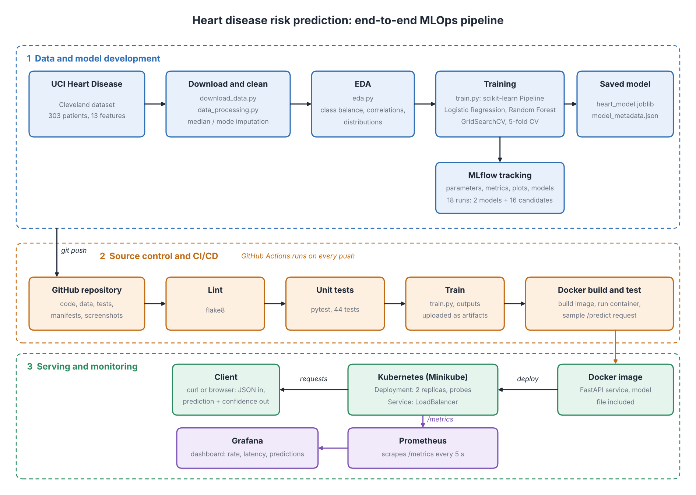

# Heart Disease Risk Prediction: MLOps Pipeline

An end-to-end MLOps project that predicts heart disease risk from patient health data
(UCI Heart Disease, Cleveland subset). It covers data preparation, experiment tracking,
automated testing and CI/CD, a containerised prediction API, Kubernetes deployment and
monitoring.



## Results

Selected model: **Logistic Regression** (best cross-validated ROC-AUC). Models were tuned with
5-fold stratified cross-validation on a stratified 80/20 split (242 training / 61 test patients).

| Model | CV accuracy | CV precision | CV recall | CV ROC-AUC | Test accuracy | Test precision | Test recall | Test ROC-AUC |
|---|---|---|---|---|---|---|---|---|
| Logistic Regression | 0.847 | 0.877 | 0.783 | **0.902** | 0.885 | 0.839 | 0.929 | 0.966 |
| Random Forest | 0.814 | 0.799 | 0.801 | 0.898 | 0.885 | 0.839 | 0.929 | 0.955 |

Full numbers are in `results/model_comparison.csv`; the saved model's details are in
`models/model_metadata.json`.

## Repository layout

```
.
├── .github/workflows/ci.yml   CI/CD pipeline (lint, tests, training, Docker build and test)
├── data/                      cleaned dataset (heart_clean.csv); raw data is downloaded here
├── docs/                      architecture diagram
├── k8s/                       Kubernetes manifests (Deployment, Service)
├── models/                    saved model (heart_model.joblib) and metadata
├── monitoring/                Prometheus, Grafana and docker-compose for the monitoring stack
├── notebooks/                 EDA notebook(s)
├── results/                   model comparison table
├── screenshots/               evidence for the report (EDA, MLflow, CI/CD, Docker, Kubernetes, monitoring)
├── src/
│   ├── download_data.py       downloads the dataset
│   ├── data_processing.py     loading and cleaning
│   ├── eda.py                 exploratory plots
│   ├── train.py               training, tuning, MLflow tracking, model packaging
│   ├── predict.py             inference helper
│   └── api.py                 FastAPI service
├── tests/                     pytest unit tests
├── Dockerfile
├── requirements.txt           training dependencies (pinned)
├── requirements-api.txt       API dependencies (pinned)
└── requirements-dev.txt       test and lint dependencies (pinned)
```

## Setup

Requires Python 3.13 (the version used for development and CI) and Git.

```bash
git clone https://github.com/ashutoshdeshpande91/MLOps_Assign1.git
cd MLOps_Assign1
python -m venv .venv
source .venv/Scripts/activate        # Git Bash on Windows; use .venv/bin/activate on Linux/macOS
pip install -r requirements.txt -r requirements-api.txt -r requirements-dev.txt
```

## Run the pipeline

Run everything from the repository root.

```bash
python src/download_data.py     # downloads the raw data to data/raw/
python src/data_processing.py   # cleans it and writes data/heart_clean.csv
python src/eda.py               # writes plots to screenshots/eda/
python src/train.py             # trains, tunes, logs to MLflow, saves models/heart_model.joblib
python src/predict.py           # prediction for a built-in sample patient
```

The cleaned dataset is committed, so `train.py` also works without downloading anything.

### Data cleaning

- Missing values (`?` in the source file) are filled with the median for numeric columns and the
  mode for categorical columns (`ca` and `thal` have a few).
- The target is converted to binary: 0 = no disease, 1 = disease present (original values 1 to 4).
- Numeric features are scaled and categorical features are one-hot encoded inside the scikit-learn
  pipeline, so training and serving apply identical transformations.

### Experiment tracking

`train.py` logs to a local MLflow store (`mlflow.db`, `mlruns/`): parameters, cross-validated and
test metrics, ROC curve, confusion matrix, feature importance, the dataset and the fitted pipeline.
Each grid-search candidate is logged as a child run.

```bash
mlflow ui --backend-store-uri sqlite:///mlflow.db     # open http://127.0.0.1:5000
```

## Tests and linting

```bash
flake8 src tests
pytest
```

The tests use small synthetic data, so they need no network access.

## CI/CD

`.github/workflows/ci.yml` runs on every push and pull request to `main` and can be started
manually from the Actions tab. Jobs:

1. **Lint and unit tests**: flake8, then pytest (JUnit report uploaded as an artifact).
2. **Train model**: runs `src/train.py` and a prediction smoke test; logs and outputs are uploaded as artifacts.
3. **Build and test Docker image**: builds the image, starts the container, waits for `/health`,
   then sends a real `/predict` request.

Jobs 2 and 3 only run if job 1 passes, so a lint or test failure stops the pipeline and the logs show why.

## Prediction API

Endpoints:

| Method | Path | Purpose |
|---|---|---|
| GET | `/health` | health check; reports whether the model loaded |
| POST | `/predict` | prediction and confidence for one patient |
| GET | `/metrics` | Prometheus metrics |
| GET | `/docs` | interactive API documentation |

Run locally without Docker:

```bash
uvicorn api:app --app-dir src --port 8000
```

Sample request:

```bash
curl -X POST http://localhost:8000/predict \
  -H "Content-Type: application/json" \
  -d '{"age":63,"sex":1,"cp":1,"trestbps":145,"chol":233,"fbs":1,"restecg":2,"thalach":150,"exang":0,"oldpeak":2.3,"slope":3,"ca":0,"thal":6}'
```

Example response (the values vary with the input):

```json
{"prediction": 1, "confidence": 0.85, "probability_disease": 0.85, "label": "heart disease"}
```

Invalid input (missing or out-of-range fields) returns HTTP 422. Every request is logged with a
request ID, status code and latency.

## Docker

```bash
docker build -t heart-api .
docker run -d --name heart-api -p 8000:8000 heart-api
curl localhost:8000/health
docker logs heart-api
```

The image installs only `requirements-api.txt`, includes the saved model, and runs as a non-root user.

## Kubernetes (Minikube)

```bash
minikube start --driver=docker
docker build -t heart-api:latest .
minikube image load heart-api:latest
kubectl apply -f k8s/
kubectl get pods,deployments,services
```

The Deployment runs 2 replicas with readiness and liveness probes on `/health`. The Service is of
type `LoadBalancer`. To reach it, either run `minikube tunnel` in a second terminal and use the
service's external IP, or:

```bash
kubectl port-forward service/heart-api 8080:80
curl http://localhost:8080/health
```

## Monitoring

The API exposes Prometheus metrics at `/metrics`: request counts by endpoint and status code,
request latency, predictions by class and prediction confidence.

```bash
docker compose -f monitoring/docker-compose.yml up -d --build
```

| Service | URL | Notes |
|---|---|---|
| API | http://localhost:8000 | |
| Prometheus | http://localhost:9090 | Status, then Targets, should show `heart-api` as UP |
| Grafana | http://localhost:3000 | login `admin` / `admin`; dashboard "Heart Disease API" is pre-loaded |

Stop with `docker compose -f monitoring/docker-compose.yml down`.

In GitHub Codespaces, container-to-container traffic is blocked, so Prometheus and Grafana reach the
other services through the host's published ports (`host.docker.internal`). This is configured in
`monitoring/docker-compose.yml` and works on a normal Docker installation too.

## Dataset

UCI Machine Learning Repository, Heart Disease dataset, Cleveland processed file
(`processed.cleveland.data`): 303 patients, 13 features and a diagnosis column.

blank line for demo purpose 